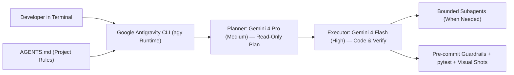

# AI-Assisted Engineering Workflow & Architecture

This guide explains how **Market Radar Demo** was built from the command line using **Google Antigravity CLI (`agy`)**, Gemini's native **Plan Mode**, an `AGENTS.md` project contract, modular **Skills**, and automated **Guardrails**—a clean, approachable setup anyone can follow without heavy ceremony.

## Executive Summary

Reliable AI-assisted engineering comes from separating **planning**, **execution**, **project context**, **domain playbooks**, and **safety checks** into clear layers:

| Layer | What Runs Here | Core Responsibility |
|---|---|---|
| **Terminal Runtime** | **Google Antigravity CLI (`agy`)** | Terminal execution engine: sandboxed commands, file tools, Plan Mode, and subagent spawning. |
| **Project Contract** | **`AGENTS.md`** | Repository-level instructions giving the AI agent build/test commands, architecture rules, and conventions. |
| **Orchestration Mode** | **Planner:** `Gemini 4 Pro (Medium)`<br>**Executor:** `Gemini 4 Flash (High)` | Separates read-only architectural planning from fast, verified implementation. |
| **Subagent Delegation** | **Bounded Subagents** | Isolates heavy codebase exploration, parallel tasks, or independent verification. |
| **Specialized Skills** | `yahoo-finance`, `modern-web-guidance`, `impeccable`, `web-design-guidelines`, `cognitive-doc-design` | On-demand playbooks that replace guesswork with verified patterns and browser/API standards. |
| **Deterministic Guardrails** | `enableTerminalSandbox`, Plan Mode lock, `pytest`, `agent-secret-guard` (`gitleaks`) | Automated boundaries that prevent unsafe commands, unverified edits, and leaked secrets. |

---

## 1. Architecture & Terminology

Beginners often treat an AI coding tool as a single black-box chat. Breaking the workflow into four simple building blocks makes it easy to reproduce on any project:



### Terminal Runtime: Google Antigravity CLI (`agy`)

**Antigravity (`agy`)** is the terminal-based agent runtime. It provides:
- **Terminal Sandboxing (`enableTerminalSandbox: true`)**: Commands run inside an isolated sandbox by default; explicit elevation is requested only for host port binding, network fetches, or git lock/SSH operations.
- **Built-in Plan Mode**: Switches the agent into a read-only planning phase before any code is modified.
- **Tooling & Subagents**: Native file read/edit/write tools, web search, and isolated background subagents when a task benefits from delegation.

### What Is `AGENTS.md`?

If `README.md` is the front door for **human** developers, **`AGENTS.md`** is the front door for **AI coding agents**.

It is a plain Markdown file placed in the root of a repository that automatically gives the agent:
- **Project conventions & architecture**: Naming rules, design patterns, and folder structure.
- **Exact commands to run**: How to install dependencies, run tests (`uv run --with pytest ...`), and start the local server.
- **Boundaries & non-goals**: What the agent should never do (e.g., never commit secrets, never add AI attribution to commits, or never alter existing public contracts without approval).

Instead of repeating *"remember to use `uv` and run `pytest`"* in every prompt, `AGENTS.md` makes those instructions durable and automatic for every session and contributor.

### What Is "Orchestration Mode"? (And Why Single-Chat Prompting Fails at Scale)

In naive single-chat prompting, one LLM session reads dozens of files, debates architecture, writes code, and reviews its own output inside an ever-growing context window. As context fills up, signal drowns in noise ("context rot"): earlier constraints get forgotten, edits drift, and the model wastes reasoning capacity on mechanical tasks (or rushes architectural decisions).

**Orchestration Mode** solves this by treating the main session as a **thin coordinator** operating along two axes:

1. **Vertical Orchestration (Plan → Execute Hand-off):**
   - **Planner (`Gemini 4 Pro (Medium)`)** starts in read-only **Plan Mode**. It cannot edit project files; its only job is to inspect the codebase, load relevant skills, resolve tradeoffs, and produce an explicit step-by-step plan with verification commands and `"Re-plan if"` triggers.
   - **Executor (`Gemini 4 Flash (High)`)** receives the approved plan with Plan Mode disabled. It applies the edits quickly, runs `pytest` and visual checks, and **hands back** to the Planner if a verification check fails twice or an assumption breaks—never guessing past the plan.
2. **Horizontal Orchestration (Parent Thread → Bounded Subagents):**
   - The main thread stays focused on decisions and synthesis rather than dumping massive search logs into its own context.
   - When a task requires broad codebase mapping, independent parallel work, or a fresh pair of eyes to verify a risky change, Antigravity spawns an isolated subagent (`define_subagent` / `invoke_subagent`) that returns only a concise summary.

---

## 2. What Are Skills vs. Guardrails? (A Learner's Mental Model)

Newcomers often confuse **skills** and **guardrails** because both shape how an AI agent behaves. In practice, they play opposite, complementary roles:

| Dimension | Skills (Additive Capability) | Guardrails (Preventive Boundaries) |
|---|---|---|
| **Core question** | *"How do we build X to a high standard?"* | *"What must never break, leak, or bypass checks?"* |
| **How they run** | Loaded **on demand** by the agent when a task matches a domain (`SKILL.md` + scripts/CLI). | Enforced **deterministically** by the runtime, sandbox, test runner, or Git hooks—even if the model forgets. |
| **Failure mode prevented** | Outdated APIs, generic "AI-slop" styling, sloppy docs, or wrong domain formulas. | Leaked API keys/private keys, unauthorized file mutations, broken contracts, or unverified regressions. |
| **Examples in this repo** | `yahoo-finance`, `modern-web-guidance`, `impeccable`, `web-design-guidelines`, `cognitive-doc-design` | `enableTerminalSandbox`, read-only Plan Mode lock, `pytest` integrity suite, `pre-commit` + `gitleaks` |

### Specialized Skills Used in This Project

Skills are modular `SKILL.md` instruction packages loaded dynamically when a task matches their domain. Instead of relying on stale training weights, the agent consults authoritative, up-to-date playbooks before editing:

| Skill | Origin / Scope | What It Contributed to Market Radar Demo |
|---|---|---|
| **`yahoo-finance`** | Project skill (`.agents/skills/yahoo-finance`) | Guided safe `yfinance` data extraction, historical price windows, and fundamental fields in `scripts/build_radar.py`. |
| **`modern-web-guidance`** | Global plugin (`modern-web-guidance`) | Enforced Baseline modern web APIs with progressive fallbacks: `<dialog closedby="any">`, HTML Invoker Commands (`commandfor`/`command="--sort"`), `Element.prototype.moveBefore()`, `light-dark()`, and `color-mix(in oklab, ...)` to prevent washed-out or hue-shifted tints. |
| **`impeccable`** | Project skill (`.agents/skills/impeccable`) | Guided visual hierarchy, WCAG AA contrast checks, replacing generic dark-cyan "AI aesthetics" with the **botanical sage & warm paper / deep moss** palette, and running automated headless browser captures (`impeccable shot`) at `1440x900` and `390x844`. |
| **`web-design-guidelines`** | Project skill (`.agents/skills/web-design-guidelines`) | Supplemented accessibility, semantic landmarks, keyboard navigation (`/` search focus, dialog arrow stepping), and responsive table behavior. |
| **`cognitive-doc-design`** | Global skill | Structured documentation (`README.md` and this guide) around low cognitive load: lead with the answer, progressive disclosure, tables over dense prose, and scannable sections. |

#### How to Install & Reuse These Skills (`skills.sh` or Copy-Paste)

You can add any of these skills to your own repository in two ways:

1. **Via `skills.sh` CLI** (installs into `.agents/skills/` and records versions in `skills-lock.json`):
   ```bash
   # Financial data & yfinance patterns
   npx skills add gracefullight/stock-checker --skill yahoo-finance

   # Accessibility & web UI guidelines
   npx skills add vercel-labs/agent-skills --skill web-design-guidelines
   ```
2. **Via manual copy-paste:** Copy any skill folder (containing `SKILL.md` plus optional `scripts/` or `references/`) directly into your project's `.agents/skills/<skill-name>/` directory (or your global Antigravity skills directory). In this setup, `.agents/skills/impeccable`, `.agents/skills/yahoo-finance`, and `.agents/skills/web-design-guidelines` live locally in `.agents/skills/` (with `skills-lock.json` committed to the repo), while `modern-web-guidance` runs via `npx -y modern-web-guidance@latest`.

### Deterministic Guardrails Enforced in This Project

Guardrails do not trust LLM willpower—they are automated gates enforced by the environment and repository tooling:

| Guardrail | Mechanism | What It Protects |
|---|---|---|
| **Terminal Sandbox** | Antigravity `enableTerminalSandbox: true` | Isolates shell commands from arbitrary network access and host state unless the user explicitly approves elevation. |
| **Plan Mode Read-Only Lock** | Gemini Plan Mode | Prevents the Planner from mutating files during investigation and forces explicit verification criteria before edits begin. |
| **Commit Secret & Key Guard** | `install-guardrails` (`.pre-commit-config.yaml` + `gitleaks` + `detect-private-key`) | Scans every staged change before `git commit` completes, blocking hardcoded tokens, credentials, or private keys. |
| **Automated Integrity & Factor Suite** | `pytest` (`tests/test_build_radar.py`, `tests/test_site_integrity.py`) | Verifies quantitative formulas, offline snapshot schema, accessibility attributes, favicon presence, and documentation links. |

#### How to Install the Pre-Commit Secret Guardrails

**What it is for:** When working fast with AI agents, it is easy to paste an `.env` token, API key, or SSH private key into a file. The pre-commit guardrail (powered by [`LeanoA/agent-secret-guard`](https://github.com/LeanoA/agent-secret-guard)) runs **`gitleaks`** (`v8.30.1`) and **`detect-private-key`** (`pre-commit-hooks v6.0.0`) locally on every `git commit` and blocks the commit before any secret ever enters Git history.

**How to set it up in any repository:**
```bash
# 1. Install pre-commit (once on your machine)
brew install pre-commit   # or: pipx install pre-commit

# 2. Copy .pre-commit-config.yaml from this repo (or install via agent-secret-guard)
#    and activate the git hook in your repo:
pre-commit install

# 3. Scan existing tracked files right away:
pre-commit run --all-files
```
Commit `.pre-commit-config.yaml` so every collaborator (and AI agent) gets the exact same protection.

---

## 3. Key Takeaways for Learners

If you are studying how to build production-grade software with AI agents, four habits from this demo matter most:

- **Concepts > Code**: Know *why* CSS `display: flex` overrides the HTML `[hidden]` attribute, or *why* `color-mix(in oklab, ...)` behaves better than `in oklch` near low chroma—the agent accelerates execution, while you own architectural judgment.
- **Start with `AGENTS.md` + Plan Mode**: Give the agent clear project rules in `AGENTS.md` and let `Gemini 4 Pro` plan read-only before `Gemini 4 Flash` edits files.
- **Automated Verification Gates**: Every UI and pipeline change is backed by deterministic checks (`uv run --with pytest --with pandas --with numpy pytest -v`), integrity assertions (`tests/test_site_integrity.py`), visual viewport captures, and pre-commit secret scanning.
- **Explicit Disclaimers & Ownership**: Public AI-built demos must clearly document data sources, trademark non-affiliation (`Yahoo Finance`, `S&P 500®`, `yfinance`), and non-advisory boundaries.
