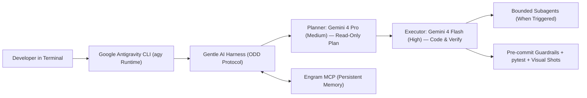

# AI-Assisted Engineering Workflow & Architecture

This guide explains how **Market Radar Demo** was built from the command line using a structured AI engineering setup—clarifying how the terminal runtime, the **Gentle AI** harness, the **Plan/Execute** model pairing, persistent memory, and specialized skills work together.

## Executive Summary

Modern AI-assisted software engineering is most reliable when **reasoning**, **execution**, **domain knowledge**, and **verification** are separated into explicit layers:

| Layer | What Runs Here | Core Responsibility |
|---|---|---|
| **Runtime Platform** | **Google Antigravity CLI (`agy`)** | Terminal execution engine: sandboxed commands, file tools, MCP servers, and native subagent spawning. |
| **Harness & Methodology** | **Gentle AI — Organic Driven Development (ODD)** | Behavioral rules, authorization gates, context-budget discipline, and risk classification. |
| **Dual-Model Orchestrator** | **Planner:** `Gemini 4 Pro (Medium)` **Executor:** `Gemini 4 Flash (High)` | Separates read-only architectural planning from fast, verified implementation. |
| **Delegation Topology** | **Dynamic Bounded Subagents** | Isolates heavy exploration, parallel independent work units, or high-risk independent verification. |
| **Persistent Memory** | **Engram (MCP Server)** | Stores architectural decisions, root causes, and session handoffs across sessions. |
| **Specialized Skills** | `yahoo-finance`, `modern-web-guidance`, `impeccable`, `web-design-guidelines`, `cognitive-doc-design` | On-demand playbooks that replace guesswork with verified patterns and browser/API standards. |
| **Commit Guardrails** | `agent-secret-guard` (`pre-commit` + `gitleaks`) | Automated secret and private-key scanning on every commit. |

---

## 1. Architecture & Terminology (Runtime vs. Harness vs. Models)

Beginners often conflate the CLI tool, the workflow rules, and the underlying LLM. Separating those three concepts makes it clear why the system stays predictable:

### Runtime Platform: Google Antigravity CLI (`agy`)

**Antigravity (`agy`)** is the terminal-based agent runtime—not the methodology itself. It provides:
- **Terminal Sandboxing (`enableTerminalSandbox: true`)**: Commands run inside an isolated sandbox by default; explicit elevation is requested only for host port binding, network fetches, or git lock/SSH operations.
- **Tooling & MCP**: Native file read/edit/write tools, web search, and Model Context Protocol (MCP) connections such as **Engram**.
- **Native Subagent Lifecycle**: Spawns isolated background or read-only workers (`define_subagent` / `invoke_subagent`) without polluting the main conversation context.

### Harness & Methodology: Gentle AI & Organic Driven Development (ODD)

**Gentle AI** is the configuration and orchestration harness layered on top of Antigravity. Its default workflow, **Organic Driven Development (ODD)**, enforces a strict sequence on every request:

1. **Authorize**: Distinguish read-only exploration/questions from mutations before editing any file.
2. **Explore**: Inspect the existing codebase proportionally before proposing changes.
3. **Resolve Uncertainty**: Ask one focused question for real product ambiguities instead of guessing.
4. **Classify**: Size the task (`small` vs. `large`) by whether work can be resumed cleanly from the request and `git diff` alone—not by arbitrary file counts.
5. **Track**: Large multi-session features create a specification/task logbook (`odd/tasks/<feature>.md` + Engram mirror); small understood changes stay inline without ceremony.
6. **Implement & Verify**: Execute step by step, run focused tests and suites, and close every code change with an explicit **Risk line** (`Risk: none` or `Risk: item N`).

### Dual-Model Pairing: Orchestrator (Plan / Execute)

Rather than asking a single model call to think through architecture and grind through repetitive edits at the same time, the **Orchestrator** configuration splits the loop across two specialized models:

- **Planner — `Gemini 4 Pro (Medium)`**: Runs in read-only **Plan Mode**. It investigates the codebase, loads relevant skills, makes architectural tradeoffs, and writes a concrete step-by-step plan with explicit verification commands and re-plan triggers.
- **Executor — `Gemini 4 Flash (High)`**: Receives the approved plan with Plan Mode disabled. It executes edits rapidly, runs `pytest` and visual checks, and hands control back to the Planner if a step fails twice or a hidden assumption breaks.

### Subagent Delegation (Why & When)

Keeping the parent thread thin prevents context rot. Under Gentle AI ODD, subagents are **never** spawned just because a task feels big—they fire only for concrete triggers:
- **Mapping trigger**: Exploration exceeds a single small read batch (~5+ lookups), so a read-only explorer maps the code and returns concise `path:line` evidence.
- **Writer trigger**: Two or more genuinely independent units with disjoint files can run in parallel, or the parent context approaches its backstop.
- **Verification trigger**: A change touches a named **high-risk item** (irreversible data migrations, security/auth, breaking public contracts, concurrency, CI/deploy, or untested paths), earning an independent read-only verifier.

### Persistent Memory: Engram (MCP)

LLMs start every session stateless. **Engram** gives the agent structured, project-scoped long-term memory (`mem_context`, `mem_search`, `mem_save`, `mem_session_summary`) so decisions (such as adopting the botanical sage pastel palette), bug root causes (such as `display: flex` overriding `[hidden]`), and repository publication states survive across sessions and context compactions.

---

## 2. Specialized Skills & Guardrails Used in This Project

Skills are modular `SKILL.md` instruction packages loaded dynamically when a task matches their domain. Instead of relying on stale training weights, the agent consults authoritative, up-to-date playbooks before editing.

| Skill / Plugin | Origin / Scope | What It Contributed to Market Radar Demo |
|---|---|---|
| **`yahoo-finance`** | Project skill (`.agents/skills/yahoo-finance`) | Guided safe `yfinance` data extraction, historical price windows, and fundamental fields in `scripts/build_radar.py`. |
| **`modern-web-guidance`** | Global plugin (`modern-web-guidance`) | Enforced Baseline modern web APIs with progressive fallbacks: `<dialog closedby="any">`, HTML Invoker Commands (`commandfor`/`command="--sort"`), `Element.prototype.moveBefore()`, `light-dark()`, and `color-mix(in oklab, ...)` to prevent washed-out or hue-shifted tints. |
| **`impeccable`** | Project skill (`.agents/skills/impeccable`) | Guided visual hierarchy, WCAG AA contrast checks, replacing generic dark-cyan "AI aesthetics" with the **botanical sage & warm paper / deep moss** palette, and running automated headless browser captures (`impeccable shot`) at `1440x900` and `390x844`. |
| **`web-design-guidelines`** | Project skill (`.agents/skills/web-design-guidelines`) | Supplemented accessibility, semantic landmarks, keyboard navigation (`/` search focus, dialog arrow stepping), and responsive table behavior. |
| **`cognitive-doc-design`** | Gentle AI global skill | Structured documentation (`README.md` and this guide) around low cognitive load: lead with the answer, progressive disclosure, tables over dense prose, and scannable sections. |
| **`install-guardrails`** | Project plugin (`.agents/plugins/agent-secret-guard`) | Installed `.pre-commit-config.yaml` with `gitleaks` secret scanning and private-key detection, automatically verified on every `git commit`. |

---

## 3. Key Takeaways for Learners

If you are studying how to build production-grade software with AI agents, four habits from this demo matter most:

- **Concepts > Code**: Know *why* CSS `display: flex` overrides the HTML `[hidden]` attribute, or *why* `color-mix(in oklab, ...)` behaves better than `in oklch` near low chroma—the agent accelerates execution, while you own architectural judgment.
- **Read-Only Planning Before Mutation**: Separating planning (`Gemini 4 Pro`) from execution (`Gemini 4 Flash`) catches mismatched assumptions before files are edited.
- **Automated Verification Gates**: Every UI and pipeline change is backed by deterministic checks (`uv run --with pytest --with pandas --with numpy pytest -v`), integrity assertions (`tests/test_site_integrity.py`), visual viewport captures, and pre-commit secret scanning.
- **Explicit Disclaimers & Ownership**: Public AI-built demos must clearly document data sources, trademark non-affiliation (`Yahoo Finance`, `S&P 500®`, `yfinance`), and non-advisory boundaries.
